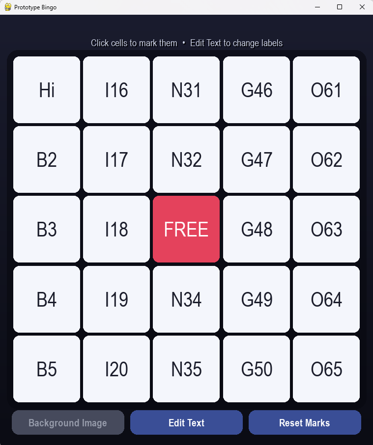

# Prototype Bingo

A small desktop bingo board built with pygame. It's meant for
prototyping board layouts where the squares hold longer text than a
normal bingo game --- descriptions, questions, whatever --- so the cell
text wraps and shrinks to fit instead of overflowing.



------------------------------------------------------------------------

## Table of contents

-   [Features](#features)
-   [Requirements](#requirements)
-   [Installation](#installation)
-   [Running it](#running-it)
-   [Controls](#controls)
-   [How the text fitting works](#how-the-text-fitting-works)
-   [Save file](#save-file)
-   [Configuration and tweaking](#configuration-and-tweaking)
-   [Project layout](#project-layout)
-   [Troubleshooting](#troubleshooting)
-   [FAQ](#faq)
-   [Re-enabling the background
    picker](#re-enabling-the-background-picker)
-   [Roadmap](#roadmap)
-   [Contributing](#contributing)
-   [License](#license)
-   [Changelog](#changelog)

------------------------------------------------------------------------

## Features

-   **5×5 board.** Click a cell to mark it. Marks show up in red.
-   **Editable cell text.** Click "Edit Text" (or press `E`), then click
    any cell to retype its label. A small popup opens; type and hit
    Enter.
-   **Text that fits itself.** Long labels wrap onto multiple lines and
    shrink automatically. If a label is still too long at the minimum
    readable size, it gets truncated with `…`.
-   **Bingo detection.** Completing any row, column, or diagonal lights
    the winning cells up in gold and shows a pulsing "B I N G O !"
    banner.
-   **Autosave.** Edits and marks are written to `bingo_save.json` next
    to the script. Close the app, reopen it, and your board is exactly
    as you left it.
-   **Resizable window.** The board, text, and buttons scale with the
    window.
-   **No dependencies beyond pygame.** One file, one import, one save
    file.

The "Background Image" button is visible but **deliberately disabled**
--- it's greyed out and clicks do nothing. The file-dialog code is still
in place (`choose_background`) so it's a three-line change to bring it
back. See [Re-enabling the background
picker](#re-enabling-the-background-picker).

## Requirements

  Python     3.8+        Tested on 3.10
  `pygame-ce`   \= 2.5.8   The only pip dependency

Optional:

  `tkinter`                           Only if you re-enable the background
                                      picker. Ships with Python on
                                      Windows/macOS. On Debian/Ubuntu:
                                      `sudo apt install python3-tk`. On
                                      Fedora:
                                      `sudo dnf install python3-tkinter`.
                                      On Arch: `sudo pacman -S tk`.

The `requirements.txt` is a single line:

``` text
pygame-ce==2.5.8
```

## Installation

``` bash
git clone <your-repo-url>
cd <repo-folder>
pip install -r requirements.txt
```

Or if you're not cloning, drop `bingo.py` anywhere and just install
pygame:

``` bash
pip install pygame
```

## Running it

``` bash
python bingo.py
```

The window opens at 760×880 and can be resized. The board scales to fit
whatever space is available; buttons and text scale with it.

## Controls

| Action | Instruction |
|---|---|
| Mark / unmark a cell | Left-click the cell |
| Enter edit mode | Click "Edit Text" or press `E` |
| Leave edit mode | Click "Edit Text" again or press `Esc` |
| Edit a cell's text | In edit mode, click the cell |
| Save a text edit | Press `Enter` in the popup box |
| Cancel a text edit | Press `Esc` in the popup box |
| Clear the popup's text | Press `Delete` in the popup box |
| Clear all marks | Click "Reset Marks" or press `R` |
| Quit | Close the window |

The FREE center square stays marked when you reset. Marks and edits are
saved automatically --- there's no manual save step.

The board starts with defaults (`B1`--`O65`, FREE in the middle) only on
the very first run when no save file exists.

## How the text fitting works

Each cell runs a two-pass routine on its label:

1.  **Wrap.** `wrap_text()` splits the string into lines that fit inside
    the cell's inner width. Long words that exceed the width on their
    own get chopped mid-word rather than pushed out of the box. Explicit
    `\n` characters in the label also break lines.
2.  **Shrink.** `fit_text()` tries font sizes from the cell's maximum
    down to a readable minimum, and picks the largest size whose
    *wrapped* lines still fit vertically inside the cell.

If even the minimum size overflows the cell height, the last visible
line is truncated with `…`. As a final safety net, the draw call is
clipped to the cell rectangle in `draw_cell_text()`, so even a
pathological case (e.g. 200 characters pasted into a single cell) can't
bleed into a neighbouring square.

Two tuning constants live at the top of `draw_cell_text()`:

``` python
max_size = max(9, int(cs * 0.30))   # 30% of cell height
min_size = max(7, int(cs * 0.09))   # floor before ellipsis
```

Raise `max_size` for bigger short labels; raise `min_size` if your long
labels are getting too small to read comfortably.

## Save file

Autosaves live at `bingo_save.json` in the same folder as `bingo.py`.
Structure:

``` json
{
  "version": 1,
  "texts": [
    ["B1", "I16", "N31", "G46", "O61"],
    ["B2", "I17", "Quarterly Revenue", "G47", "O62"],
    ["B3", "I18", "FREE", "G48", "O63"],
    ["B4", "I19", "N34", "G49", "O64"],
    ["B5", "I20", "N35", "G50", "O65"]
  ],
  "marked": [
    [false, false, false, false, false],
    [false, true,  false, false, false],
    [false, false, true,  false, false],
    [false, false, false, false, false],
    [false, false, false, false, false]
  ]
}
```

Behaviour:

-   Written every time you edit a cell, mark a cell, or reset. Also
    written on shutdown.
-   Written atomically --- the game writes to `bingo_save.json.tmp`,
    then does an `os.replace`. A crash mid-write leaves the previous
    good file intact rather than a half-written one.
-   If the file is missing, the board starts at defaults (no warning).
-   If the file is malformed or the grids are the wrong shape, the game
    falls back to defaults and shows a warning in the status line ---
    the bad file is left untouched so you can inspect it.
-   Deleting `bingo_save.json` resets the board to defaults on the next
    launch.

If you're putting this in a git repo, add `bingo_save.json` to
`.gitignore` --- it's user data, not source.

## Configuration and tweaking

Everything lives in `bingo.py` as module-level constants near the top:

| Constant | Default | What it does |
|---|---|---|
| `MAX_CELL_CHARS` | `40` | Max characters you can type into one cell. Raise it for long-form labels. |
| `SAVE_FILE` | `bingo_save.json` next to the script | Where autosave writes. |
| `CELL_FACE` / `CELL_FACE_HOVER` | Pale greys | Unmarked cell colours. |
| `CELL_MARKED` / `CELL_MARKED_HOV` | Red / bright red | Marked cell colours. |
| `CELL_TEXT` / `CELL_TEXT_MARK` | Dark / white | Text colours for unmarked / marked cells. |
| `BUTTON`, `BUTTON_HOVER`, `BUTTON_EDIT`, `BUTTON_EDIT_HOV` | Blues / ambers | Button colours. |
| `DISABLED`, `DISABLED_TEXT` | Greys | The disabled background-picker button. |
| `GOLD` | Amber | Winning-line highlight colour. |

Default board content is set in `BingoApp.__init__`:

``` python
letters = ["B", "I", "N", "G", "O"]
starts  = [1, 16, 31, 46, 61]
self.texts = [[f"{letters[c]}{starts[c] + r}" for c in range(5)]
              for r in range(5)]
self.texts[2][2] = "FREE"
```

Change letters and starts if you want a different default grid, or just
edit the cells in the app.

## Project layout

``` text
.
├── bingo.py            # the whole game, single file
├── bingo_save.json     # created on first edit (gitignored)
├── requirements.txt
├── README.md
└── screenshot.png
```

`bingo.py` is laid out top to bottom as:

1.  Imports and optional tkinter guard
2.  Colour constants
3.  `wrap_text()` --- line breaking
4.  `BingoApp` class
5.  `__init__` / `update_layout` --- state and geometry
6.  `get_font` / `fit_text` / `render_fitted` --- font sizing helpers
7.  `bingo_lines` / `bingo_cells` --- win detection
8.  `save_state` / `load_state` / `_valid_grid` --- JSON persistence
9.  `on_button` / `begin_edit` / `choose_background` --- actions
10. `handle_event` / `handle_typing` --- input
11. `draw_background` / `draw_board` / `draw_cell_text` / `draw_status`
    / `draw_buttons` / `draw_input_overlay` --- rendering
12. `update_cursor` --- hand-vs-arrow cursor
13. `run` --- the main loop
14. `main()` entry point

## Troubleshooting

### `ModuleNotFoundError: No module named 'pygame'`

You haven't installed pygame in the environment running the script. Run
`pip install -r requirements.txt` with the same Python you're launching
`bingo.py` with. If you use virtualenvs, make sure it's activated.

### "tkinter not installed --- can't open file dialog" toast on launch

This is expected in the current version --- the background picker is
disabled. The toast only shows if something goes wrong with the
disabled-button check. It will never appear from normal use. If you
re-enable the picker and see this, install `python3-tk` as described in
Requirements.

### My text keeps getting cut off with `…`

The label is longer than the cell can hold even at `min_size`. Either
shorten the label, raise `MAX_CELL_CHARS` (doesn't help on its own ---
this is a rendering limit, not an input limit), or lower `min_size` in
`draw_cell_text`. Truncation is per-cell, so widening the board by
resizing the window will fit more text without any code changes.

### Save file is corrupt / I want to reset

Delete `bingo_save.json` and relaunch. Defaults come back. If the file
is corrupt but still present, the game prints a warning in the status
line and uses defaults --- the bad file is left alone so you can inspect
it, but every save overwrites it with a good one.

### Board renders but buttons don't respond

If you're seeing this on Wayland, try:

``` bash
SDL_VIDEODRIVER=x11 python bingo.py
```

Pygame's Wayland support has historically been flaky around input
routing.

### `pygame.error: video system not initialized`

Happens if you import `bingo.py` without calling `pygame.init()` first,
or if you're running it from a headless session. Run it directly with
`python bingo.py` in a graphical session.

## FAQ

### Why is the background button disabled?

I wanted it there as a stub so the layout is final, but the feature
wasn't finished and I didn't want a half-working file dialog in a
"complete" tool. Re-enabling it is documented below.

### Can I change the grid size?

Not from the UI. The 5×5 layout is hardcoded --- the `self.texts` and
`self.marked` arrays are 5×5, `bingo_lines()` iterates `range(5)`, and
the FREE centre is at `[2][2]`. Making it configurable means
parameterising four or five places. Not hard, but not done.

### Where does the game save my board?

Next to `bingo.py`, in a file called `bingo_save.json`. It writes on
every edit and every mark toggle --- you don't need to press anything.

### Does it work on Windows / macOS / Linux?

Yes. Tested on Linux (X11) and Windows 10/11. macOS should work; the
only macOS-specific concern is that `pygame.image.load` on macOS
sometimes needs `convert_alpha()` to be called on a display surface ---
that's already handled in `choose_background` if you re-enable it. Core
board + editing works fine.

### Can I use this for a real bingo game?

It's designed for prototyping arbitrary board content, not a proper
caller/ball-draw bingo game. There's no ball caller, no number pool, no
"you need the centre free space" rule enforcement. It's a labelled 5×5
grid that tells you when you've completed a line --- think of it as a
bingo-shaped checklist.

### Why is the winning banner "B I N G O !" with spaces?

Because a tight BINGO! in Arial Black looks shouty and the spaced
version reads more like a real bingo-board flash. Trivial to change in
`draw_status`.

## Re-enabling the background picker

Three places to undo, all marked with comments in the code:

`on_button` --- delete the early return inside the `"bg"` branch:

``` python
if key == "bg":
    self.choose_background()
```

`handle_event` --- uncomment the `pygame.K_b` branch:

``` python
elif event.key == pygame.K_b:
    self.on_button("bg")
```

`draw_buttons` --- change `disabled = (key == "bg")` to
`disabled = False`, or just delete the variable and every line that
references it.

`choose_background()` still loads the chosen image, scales it with
`smoothscale`, and stores it in `self.bg_image`. `draw_background()`
already handles `self.bg_image` being set --- it scales the image to
cover the window and dims it with a translucent veil so the board stays
readable.

The one thing you'd also want to add: persistence of the chosen image
path. Currently `save_state` writes only `texts` and `marked`. Add
`self.bg_path` to the dict, and in `load_state` re-run the
`pygame.image.load` block from `choose_background` with the stored path.
Missing file → silently skip and stay on the gradient background.

## Roadmap

Not committing to any of these, but they're the things I'd reach for
next:

-   Persist the background image path so a custom background survives
    restarts
-   A manual "Save" button for people who don't trust autosave (mostly
    to overwrite a corrupt file cleanly)
-   Configurable grid size --- 3×3 and 4×4 are more useful for
    prototyping than people realise
-   Different mark styles (X, strike-through, dot) so marked cells are
    distinguishable in a screenshot
-   Export the board to PNG so you can drop it straight into a slide
    deck
-   Optional dark/light theme switch

None of those are in. It does exactly what the Features list says.

## Contributing

This is a personal tool, not a project with a community. If you find a
bug or want a change, the fastest path is to open the file, make the
change, and use it. If you want to send a PR anyway, the two things I'll
ask for:

-   Keep it a single file. The appeal of this thing is that it's one
    `bingo.py` you can drop anywhere. Splitting it into modules defeats
    the point.
-   Keep the honest tone in the README. No "blazing fast", no "✨
    Features ✨", no bullet-point marketing. It's a tool, not a launch.

Bug reports are welcome. Feature requests are welcome

## License

MIT. Use it, fork it, sell it, whatever. See `LICENSE` for the exact
text

## Changelog

No entries yet.
